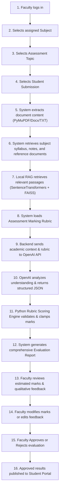

# EduEval AI — AI-Powered Academic Evaluation & Student Feedback System

EduEval AI is a complete, functional, secure, and responsive academic evaluation platform built for educational institutions. It empowers faculty members to evaluate student submissions using a **hybrid AI architecture** combining **local RAG (Sentence Transformers + FAISS)**, a **custom Python rubric scoring engine**, and the **OpenAI API** for qualitative conceptual analysis.

---

## 🌟 Key Features

### Three Dedicated Portals
1. **Admin Portal**: Institutional dashboard, faculty & student account management, subject creation, student enrollment & faculty assignment, submissions oversight, and audit logs.
2. **Faculty Portal**: Subject management, syllabus/notes/reference uploads, local FAISS RAG index building, assessment and journal creation, multi-criteria rubric configuration, submission preview, AI evaluation, subject-relevance checking, comparative-analysis feedback, line-level feedback, style and proofreading analysis, editable criterion/final marks, and approval/rejection/publication.
3. **Student Portal**: Personal dashboard, enrolled subjects, assessment and journal submissions, document/image upload, OCR extraction, submission history, and published reports with question metadata, criterion marks, relevance findings, strengths, weaknesses, language/style feedback, line-level notes, and improvement suggestions.

### Hybrid Evaluation Architecture
- **Document Processing**: Local extraction for PDF, DOC/DOCX, PPT/PPTX, TXT, and common images. Scanned pages and images use orientation-aware, contrast-enhanced Tesseract OCR; legacy Office files use LibreOffice conversion. Published reports can be downloaded as server-generated PDFs.
- **Local RAG Pipeline**: Embeddings generated locally on CPU using `sentence-transformers` (`all-MiniLM-L6-v2`) and indexed via **FAISS**. Subject-specific retrieval ensures only relevant course passages are retrieved. No institutional database content is unnecessarily leaked to external APIs.
- **Custom Python Rubric Scoring Engine**: Strictly enforces maximum marks constraints (10, 20, 25, 50, 100, or custom), validates criteria sums, clamps individual scores, and calculates totals.
- **OpenAI API Engine**: Structured JSON output validated via Pydantic for relevance, criterion marks, comparative analysis, strengths, weaknesses, missing concepts, style, proofreading, line-level feedback, and supporting evidence quotes.
- **Faculty Governance**: AI evaluation scores remain **provisional** until explicitly reviewed, adjusted, and approved by the faculty member before publication to the student.

---

## 🛠️ Technology Stack

| Layer | Technologies |
|---|---|
| **Frontend** | React 18, TypeScript, Vite, Tailwind CSS, Axios, React Router DOM, Lucide Icons, React Hot Toast |
| **Backend** | Python 3.10+, FastAPI, SQLAlchemy 2.0, Pydantic v2, Python-Jose (JWT), Passlib (Bcrypt) |
| **Database** | SQLite (zero-config, local storage with foreign keys) |
| **AI / NLP** | OpenAI Python SDK (`gpt-4o-mini` / configurable), Sentence Transformers (`all-MiniLM-L6-v2`), FAISS (CPU) |
| **Document Processing** | PyMuPDF (`fitz`), python-docx |

---

## 📂 Project Structure

```
c:\AI_FEEDACK_SYSTEM\
├── Backend/
│   ├── .env.example              # Environment variables template
│   ├── .env                      # Local secret variables (gitignored)
│   ├── requirements.txt          # Python dependencies
│   ├── test_workflow.py          # End-to-end automated testing script
│   ├── uploads/                  # Uploaded course documents & student submissions
│   ├── faiss_indexes/            # Local FAISS vector index files per subject
│   └── app/
│       ├── main.py               # FastAPI entry point & lifespan setup
│       ├── core/
│       │   ├── config.py         # Pydantic BaseSettings (loads .env)
│       │   ├── database.py       # SQLAlchemy engine & session factory
│       │   ├── security.py       # Password hashing & JWT token management
│       │   └── deps.py           # Dependency injection & role guards
│       ├── models/
│       │   └── models.py         # SQLAlchemy ORM models (20+ entities)
│       ├── schemas/
│       │   └── schemas.py        # Pydantic schemas for request/response
│       ├── services/
│       │   ├── ai/
│       │   │   ├── evaluator.py      # OpenAI API structured evaluation
│       │   │   └── rubric_scorer.py  # Python rubric math & validation
│       │   ├── rag/
│       │   │   └── pipeline.py       # SentenceTransformers + FAISS RAG
│       │   └── document/
│       │       └── processor.py      # PyMuPDF, docx, txt extractors
│       └── api/
│           └── routes/
│               ├── auth.py           # Login endpoint (/api/auth/login)
│               ├── admin.py          # Admin endpoints (/api/admin/*)
│               ├── faculty.py        # Faculty endpoints (/api/faculty/*)
│               └── student.py        # Student endpoints (/api/student/*)
├── Frontend/
│   ├── index.html
│   ├── package.json
│   ├── tsconfig.json
│   ├── vite.config.ts
│   ├── tailwind.config.js
│   └── src/
│       ├── main.tsx
│       ├── App.tsx               # Routing & protected routes
│       ├── index.css             # Tailwind base & custom design tokens
│       ├── api/
│       │   └── client.ts         # Axios client with JWT interceptor
│       ├── contexts/
│       │   └── AuthContext.tsx   # React authentication context
│       ├── components/
│       │   └── shared/
│       │       └── DashboardLayout.tsx # Shared sidebar & topbar layout
│       └── pages/
│           ├── auth/LoginPage.tsx       # 3-portal switchable login
│           ├── admin/AdminPortal.tsx    # Admin dashboard & management
│           ├── faculty/FacultyPortal.tsx # Faculty course & evaluation
│           └── student/StudentPortal.tsx # Student submission & feedback
└── .gitignore                    # Ensures .env, db, uploads, node_modules ignored
```

---

## 🔑 OpenAI API Key Configuration — Setup Guide

> [!IMPORTANT]
> **Zero Leakage Security Rule**: Never enter your OpenAI API key into frontend code, terminal logs, or git commits. The API key is loaded strictly on the backend from `Backend/.env`.

### Step 1: Open `Backend/.env`
Navigate to `Backend/.env` (or copy `Backend/.env.example` to `Backend/.env`).

```env
OPENAI_API_KEY=your_actual_openai_api_key_here
OPENAI_MODEL=gpt-4o-mini
SECRET_KEY=edueval-dev-secret-change-in-production-abc123xyz
ALGORITHM=HS256
ACCESS_TOKEN_EXPIRE_MINUTES=60
DATABASE_URL=sqlite:///./edueval.db
```

### Step 2: Enter Your Key
Replace `your_actual_openai_api_key_here` with your secret key from [OpenAI Platform](https://platform.openai.com/api-keys).

### Step 3: Graceful Fallback
If the API key is absent:
- The backend starts without crashing.
- A clear banner is printed: `⚠️ OpenAI API key NOT configured`.
- All local RAG, rubric calculations, document extraction, and portal functionalities work completely.
- AI evaluation returns a clear `503 Service Unavailable` error prompting faculty to configure the key, rather than faking scores.

---

## 🚀 Execution & Setup Instructions

### 1. Prerequisites
- Python 3.10+ (x64)
- Node.js 18+ and npm
- Standard laptop hardware (CPU only, no GPU needed)

### 2. Backend Setup
In a terminal window:
```bash
cd c:\AI_FEEDACK_SYSTEM\Backend

# Optional: activate virtual environment
# python -m venv venv
# .\venv\Scripts\Activate.ps1

# Install dependencies (already installed on this machine)
python -m pip install -r requirements.txt

# Run the automated E2E test & seed database with sample accounts:
python test_workflow.py

# Start the FastAPI server on port 8000:
python -m uvicorn app.main:app --host 127.0.0.1 --port 8000 --reload
```

The backend server is accessible at `http://127.0.0.1:8000`.
Interactive Swagger API documentation: `http://127.0.0.1:8000/docs`.

### 3. Frontend Setup
In a separate terminal window:
```bash
cd c:\AI_FEEDACK_SYSTEM\Frontend

# Start the Vite development server:
npm run dev
```

The frontend application is accessible at `http://localhost:5173`.

### 4. Production Deployment
Deploy the `Frontend` directory to Vercel and deploy the `Backend` directory to a
Python-capable service such as Render or Railway. Do not deploy the whole
repository as a single Vercel project: Vercel will not run this FastAPI server
and its SQLite database, uploads, and FAISS files are not durable production
storage.

Set these variables in the backend service, never in the frontend:

```env
OPENAI_API_KEY=<server-only-secret>
SECRET_KEY=<long-random-secret>
DATABASE_URL=<production-database-url>
CORS_ORIGINS=https://your-frontend.vercel.app
```

Set this variable in Vercel for the frontend:

```env
VITE_API_BASE_URL=https://your-backend.example.com
```

Only variables prefixed with `VITE_` are bundled into the browser. The
OpenAI key must remain a backend-only variable.

---

## 👤 Default Portal Credentials

The database comes pre-seeded with accounts for all three portals:

| Portal | Email | Password | Role / Access |
|---|---|---|---|
| **Admin** | `admin@edueval.ai` | `Admin@123` | Institutional Oversight & Management |
| **Faculty** | `dr.smith@university.edu` | `Faculty@123` | Subject documents, rubrics, evaluations |
| **Student** | `john.doe@student.edu` | `Student@123` | Upload Submissions, View Feedback |

---

## 🔄 Complete 16-Step Evaluation Process



---

## 🛡️ Security & Privacy Architecture
1. **API Key Isolation**: Kept solely on the server environment. Never shared with frontend or stored in version control.
2. **Minimal PII Exposure**: Student personal identifiers are stripped prior to AI prompt dispatch.
3. **Local Vector Storage**: Course notes and reference documents stay in local FAISS vector indices on disk.
4. **JWT Role Guards**: Route-level middleware ensures students cannot invoke faculty evaluations or view other students' records.
5. **Audit Trail**: Every significant administrative, faculty, and grading action is logged with timestamp, user ID, and resource target.
